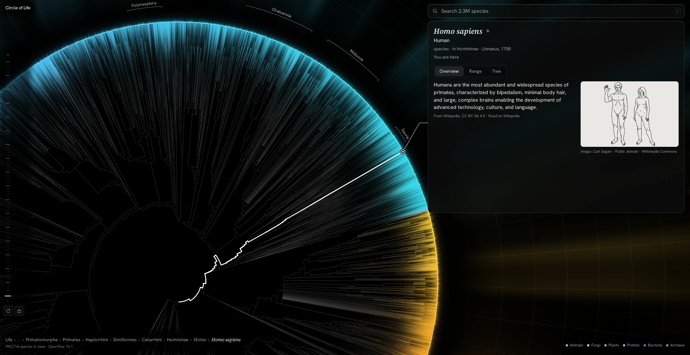
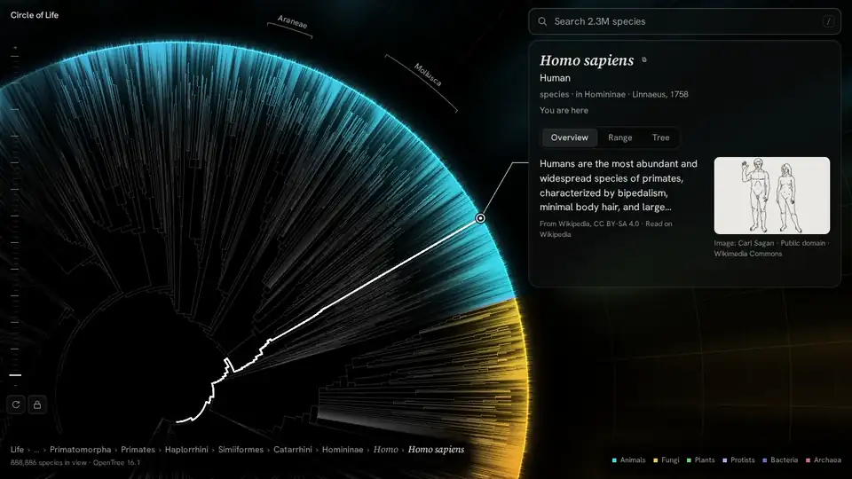
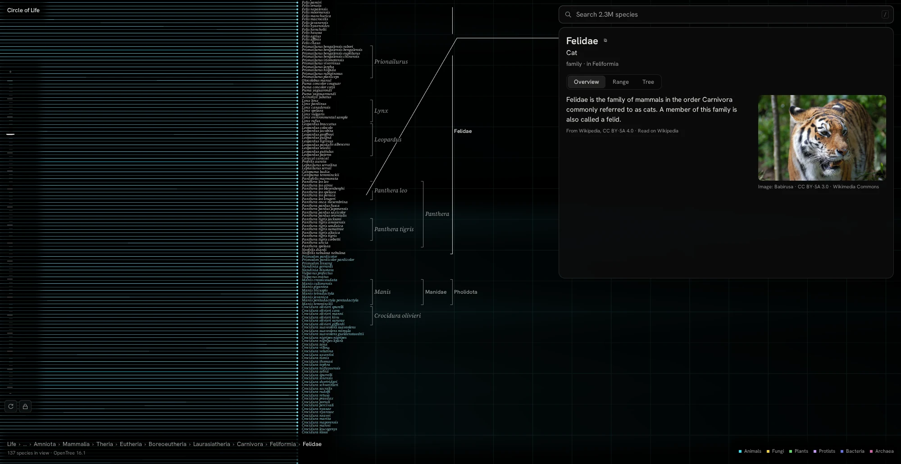
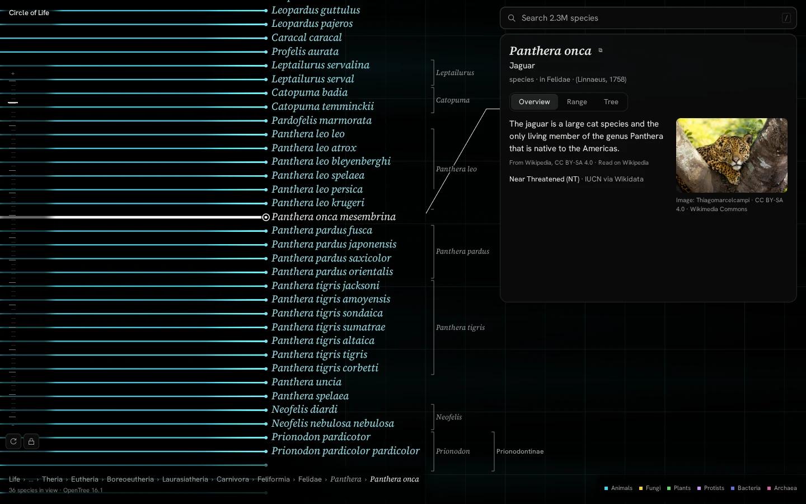
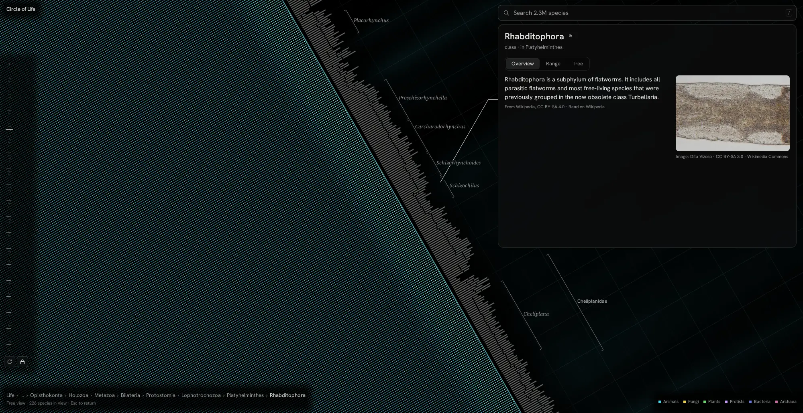
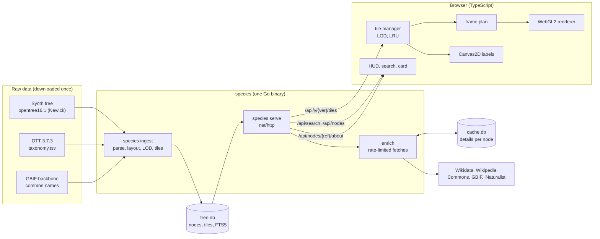

# Circle of Life

The complete tree of life on one zoomable wheel: every one of the 2.39 million tips in the Open Tree of Life synthesis, drawn in the browser.



**Live: [lifecircle.fx-labs.tech](https://lifecircle.fx-labs.tech)**

Every known lineage sits on one circle, about 2.3 million species from bacteria to blue whales. The centre is the common ancestor of all cellular life, each branch splits into the groups that descend from it, and every species ends on the rim. You start on your own species, *Homo sapiens*, and can scroll from the whole of life down to a single species, where the names read like a list.

Click any branch and a card shows what it is: a photo, a short description from Wikipedia, its conservation status, a map of where it has been recorded and the groups it belongs to. Search finds anything by scientific or common name ("jaguar", "Panthera onca", "onça") and flies there. A free view lets you leave the default framing and explore the inner branches by hand.



| Mid zoom: the cat family, genus brackets, the card and its leader | Deep zoom: one species per row | Free view at deep zoom, wheel turned |
|---|---|---|
|  |  |  |

## Technical highlights

- **2.39M tips at interactive frame rates.** Level-of-detail angular tiles (14,973 tiles, 48 MB gzipped): the client loads only what is in view and fades levels in. 1.3–7.8 ms per frame on an integrated GPU.
- **Custom binary tile format.** 4-byte-aligned struct-of-arrays, uploaded to WebGL2 without copies; u32 fixed-point angles. A golden tile is checked byte for byte in Go and TypeScript ([spec](docs/tile-format.md)).
- **Raw WebGL2 and a pure frame plan.** Instanced draws straight from the tile buffers. What to draw is a pure, unit-tested function, so the renderer only issues GL calls.
- **Stable at extreme zoom.** Camera-relative maths in doubles, a hi/lo float split and a cancellation-free formula keep jitter under 0.22 px when the rim is 115 million px around.
- **50-second ingest.** Newick tree, OTT taxonomy and GBIF names into one 650 MB SQLite file with an FTS5 index of 2.85M names. Arena tree, deterministic output.
- **Search that ranks well.** "human" finds *Homo sapiens*, "onca" equals "onça", "felidae" puts the family first.
- **Polite enrichment.** Five upstream APIs fetched on demand, cached per node, rate-limited per host, one shared fetch however many clients ask.
- **One static binary.** Go standard library plus a pure-Go SQLite. Distroless image of about 7 MB; versioned tile URLs cached `immutable`.
- **Small frontend.** Strict TypeScript, no framework: one 71 KB gzipped bundle. Accessible: ARIA combobox and tabs, live announcements, reduced motion.
- **Tested.** Go tests, 300+ Vitest tests, a Playwright smoke test of the real app and a pixel-diff screenshot harness. Originally written in Rust, then ported to Go with byte-identical tiles.

## Stack

| Technology | Used for | Why |
|---|---|---|
| Go 1.27, standard library | ingest, HTTP server, enrichment | One static binary; `net/http` routing patterns, `log/slog` and `database/sql` cover everything without a framework. |
| `modernc.org/sqlite` | `tree.db` (read-only), `cache.db` (WAL) | Pure Go, so no cgo and a static build, with FTS5 compiled in. One file to ship and back up. |
| WebGL2 + GLSL (raw API) | renderer | Runs in every current browser; full control of buffers, blending and passes; tiles upload as one buffer each. |
| Canvas2D | labels, leader lines | Text layout and glyph-level knockouts are simpler on the CPU. |
| TypeScript (strict), Vite | frontend | Type safety without a runtime cost; fast builds, shaders imported as strings. |
| Plain DOM, no framework | HUD, search, card | A small bundle and direct control of layout and accessibility. |
| Vitest, Playwright | unit tests; smoke, screenshots | Headless Chromium draws WebGL2 through SwiftShader, so the end-to-end tests need no GPU. |
| Docker (distroless static) | deployment | No shell or libc in the image; about 7 MB compressed. |

## Architecture



The work is split into an offline step and an online step.

- **Offline, `species ingest`:** parses the tree and taxonomy, assigns every node an angle and a radius, works out each node's level of detail, cuts and gzips the tiles, and writes everything into `tree.db`. It writes to a temporary file and renames it into place, so a running server never sees a half-written database.
- **Online, `species serve`:** opens `tree.db` read-only and does no computation per request. Tiles, search and node lookups are a few indexed SQLite queries each. Only `/about` reaches the network, and only on a cache miss.
- **Browser:** the tile manager decides which tiles the current view needs. The frame plan turns loaded tiles and the camera into a list of draw commands, which the WebGL2 renderer executes. Labels are drawn on a Canvas2D overlay. The HUD, search and the card are DOM above it; they register the screen areas they cover, so the renderer darkens behind them and labels keep clear.

The layout is a dendrogram with tips equally spaced on the rim. A node's radius is `r0 + (1 − r0)·d/(d + h)`, where `d` is its depth and `h` the longest path below it. Every tip lands exactly on the rim and every child sits outside its parent.

## Data

| Source | Use | Licence |
|---|---|---|
| [Open Tree of Life](https://tree.opentreeoflife.org) synthetic tree opentree16.1 | the tree: 2,725,682 nodes, 2,385,875 tips | CC0 |
| Open Tree Taxonomy 3.7.3 | names, ranks, GBIF and NCBI ids | CC0 |
| GBIF Backbone Taxonomy (2023) | English and Portuguese common names for 112,580 taxa | CC BY 4.0 |
| Wikidata, Wikipedia, Wikimedia Commons, GBIF, iNaturalist | photos, descriptions, conservation status, occurrence maps (on demand) | per source, credited in the app |

The tips per group are 1.49M animals, 442k plants, 276k fungi, 116k bacteria, 59k protists and 2k archaea.

The synthesis has **no branch lengths**, so the rings are not time and there are no dates. Large fans are honest: only about 160,000 tips are placed by phylogenetic studies, the rest are grafted from the taxonomy, so many genera show as unresolved polytomies (the largest has 12,964 children). The app labels them "relationships unresolved" rather than inventing structure.

Versions, citations and API etiquette: [`docs/data-sources.md`](docs/data-sources.md).

## Running it locally

Requirements: Go 1.27, Node 26 with pnpm, `make`, `curl`, and `unzip` (only for common names). No C toolchain.

```sh
make fetch-data            # synth tree + OTT taxonomy into data/raw (~140 MB download, ~590 MB unpacked)
make fetch-gbif            # optional: GBIF backbone (971 MB) for common names
make ingest                # builds data/tree.db (~50 s, ~1.2 GB RAM)
pnpm -C web install
make check                 # gofmt, go vet, go test, tsc, vitest

make dev                   # API on :3000 + Vite on :5173 with hot reload
# or one production process:
make build && ./bin/species serve --data data --static web/dist   # http://localhost:3000
```

No full data needed for development: `make ingest-mini` builds a small `data/mini.db` from the test fixtures and `make server-mini` serves it.

Other targets (`make help` lists them all): `make smoke` (Playwright end to end, on its own server on :3077), `make shot` (screenshots; `SHOT_COMPARE=<dir>` diffs them against earlier ones), `make lint-design`, `make docker`.

Useful URL flags: `?n=ott770315` selects a node, `?debug` shows frame times, `?debug=precision` runs the jitter test, `?nowebgl` shows the fallback page.

### Controls

| Input | Locked view (default) | Free view (the padlock) |
|---|---|---|
| Scroll, pinch | zoom about the selection | zoom about the cursor |
| Drag | turn the wheel | pan; Shift + drag turns |
| Click | select and turn it into place | select, the view stays put |
| `/` or Ctrl+K | search | search (choosing a result flies back to the locked view) |
| `Esc` | close search or dialogs | fly back to the locked view |

Data & credits opens from the "i" next to the search bar. There are no other shortcuts or settings to learn.

### Settings

Environment variables (see `.env.example`; `make` reads `.env`):

| Variable | Default | Meaning |
|---|---|---|
| `SPECIES_DATA_DIR` | `data` | directory holding `tree.db` and `cache.db` |
| `SPECIES_STATIC_DIR` | `web/dist` | built frontend |
| `PORT` | `3000` | listen port |
| `SPECIES_CONTACT` | (unset) | contact email or page for the upstream User-Agent (Wikimedia asks for one) |
| `SPECIES_PUBLIC_URL` | (unset) | public URL of the site, also sent in the User-Agent |
| `LOG_LEVEL` | `info` | `debug`, `info`, `warn` or `error` |

### Docker

The image holds the binary and `web/dist`; the data is a volume at `/data`.

```sh
make docker                # docker build -t species .
docker compose up --build  # ./data mounted at /data, http://localhost:3000
```

Three stages: `node:26-slim` builds the frontend, `golang:1.27-trixie` builds a static binary (`-trimpath -ldflags="-s -w"`), and the runtime is `gcr.io/distroless/static-debian13` running as uid 10001. `HEALTHCHECK` runs `species healthcheck`, so the image needs no curl. The server writes `cache.db` next to `tree.db`, so `/data` must be writable by the container user (a named volume already is; a bind mount needs `--user "$(id -u):$(id -g)"`). If `tree.db` is missing, the container exits with an error naming the expected path.

<details>
<summary><strong>Deploying to Coolify</strong> (self-hosted Coolify v4 with Traefik)</summary>

1. **Build `tree.db` locally:** `make fetch-data && make fetch-gbif && make ingest`. Ingest needs about 1.2 GB of RAM plus the raw data, so it runs on your machine.
2. **Create the application:** *+ New → Application → Public/Private Git repository*, this repo and branch, the **Dockerfile** build pack. Set *Ports Exposes* to `3000`.
3. **Add a persistent volume** mounted at `/data` and deploy once. The container exits with "tree database not found at /data/tree.db", which is expected; that deploy creates the volume.
4. **Upload the data** to the volume's host path (`docker volume inspect <volume-name> --format '{{.Mountpoint}}'`, usually `/var/lib/docker/volumes/<name>/_data`):
   ```sh
   rsync -avP --chown=10001:10001 data/tree.db root@your-server:/var/lib/docker/volumes/<name>/_data/
   ```
   The image has no shell, so Coolify's *Terminal* and `docker exec … sh` do not work; work on the host path. If you upload another way, `chown -R 10001:10001` that directory. You can also upload an existing `cache.db` to keep a warm cache.
5. **Set the environment:** `SPECIES_CONTACT=<email or contact page>`, `SPECIES_PUBLIC_URL=https://<your domain>`, optionally `LOG_LEVEL`. `SPECIES_DATA_DIR`, `SPECIES_STATIC_DIR` and `PORT` are set in the image; if you change `PORT`, change *Ports Exposes* to match.
6. **Set the domain and deploy.** The image's own `HEALTHCHECK` takes precedence over one set in the dashboard, so leave that off (Coolify's HTTP check would need curl or wget in the image).
7. **Verify** that cache headers and compression survive Traefik:
   ```sh
   D=https://circle.example.org
   curl -s $D/healthz                                   # ok
   curl -sI $D/ | grep -i cache-control                 # no-cache
   V=$(curl -s $D/api/meta | sed -E 's/.*"dataVersion":"([^"]+)".*/\1/')
   curl -sI -H 'Accept-Encoding: gzip' $D/api/v/$V/tiles/0/0 | grep -iE 'cache-control|content-encoding'
   #   cache-control: public, max-age=31536000, immutable
   #   content-encoding: gzip
   curl -s -o /dev/null -D - -H 'Accept-Encoding: gzip' "$D/api/search?q=homo%20sapiens" | grep -i content-encoding   # gzip
   curl -s "$D/api/nodes/ott42322/about" | head -c 200  # enrichment works (outbound HTTPS)
   ```
   woff2 and images are served uncompressed on purpose. If a header is missing, check that no Traefik middleware rewrites it, and leave Coolify's *Enable Gzip Compression* off: the app compresses its own responses.

**Updating the data:** re-ingest locally, `rsync` the new `tree.db` and restart. The data version changes, so browsers fetch the new tiles automatically. `cache.db` survives a re-ingest.

</details>

## Project layout

```
cmd/species/          CLI entry point: ingest, serve, healthcheck, version
internal/
  tree/               Newick and taxonomy parsing, radial layout, level of detail
  tiles/              binary tile encoder and reference decoder
  vernacular/         GBIF common names
  ingest/             the ingest pipeline, writes tree.db
  db/                 schema, read queries, search ranking, enrichment cache
  server/             HTTP API, gzip, caching, one-fetch-per-node flights
  enrich/             Wikidata, Wikipedia, Commons, GBIF, iNaturalist clients and rate limiting
  config/, names/, healthcheck/
web/src/
  render/             renderer interface, frame plan, canvas and pixel helpers
  gl/                 WebGL2 renderer and GLSL shaders
  tiles/              tile fetching and decoding
  ui/                 card, search, zoom strip, HUD
  rig.ts, freeview.ts, flyto.ts, labels.ts, …   camera, motion, labels
web/scripts/          Playwright smoke test, screenshot harness, pixel diff
tests/fixtures/       mini tree, golden tile, captured upstream responses
docs/                 architecture, design system, tile format, data sources
```

About 8,100 lines of Go (plus 5,000 of tests), 12,500 of TypeScript (plus 4,000 of tests) and 1,100 of shaders.

## Reading the Go code

The server is written to be read by someone learning Go: standard library first, no clever helpers. Every file opens with a header listing the "Concepts introduced here", and the first use of each language concept carries a `// LEARN:` comment, so the comments read as a short course in order:

```sh
rg "LEARN:" --type go
```

Good starting points: `cmd/species/main.go` (packages, errors as values, subcommands), `internal/server/` (handlers, middleware, `context`, `log/slog`, graceful shutdown) and `internal/tree/` (parsing and layout).

## Docs

- [`docs/ARCHITECTURE.md`](docs/ARCHITECTURE.md): architecture, measured data facts, API, ingest, frontend, renderer.
- [`docs/DESIGN.md`](docs/DESIGN.md): the visual system: colour, type, layout, motion, the locked and free views.
- [`docs/tile-format.md`](docs/tile-format.md): the tile bytes.
- [`docs/data-sources.md`](docs/data-sources.md): sources, versions, licences, etiquette.

## Credits

Inspired by the "Circle of Life" visualisation of Hinchliff et al. (2015).

- **Tree and taxonomy:** Open Tree of Life synthetic tree opentree16.1 and Open Tree Taxonomy 3.7.3, CC0. Cite Hinchliff et al. 2015, *PNAS* 112(41):12764–12769, and doi:10.5281/zenodo.3937741 and doi:10.5281/zenodo.3937750.
- **Common names:** GBIF Backbone Taxonomy (2023), CC BY 4.0, doi:10.15468/39omei.
- **Species details:** Wikidata (CC0); Wikipedia text (CC BY-SA 4.0, attributed and linked in the card); images from Wikimedia Commons and iNaturalist under the licence shown with each; occurrence data © GBIF.org contributors (CC BY 4.0); IUCN Red List categories via Wikidata or GBIF; GBIF maps over OpenMapTiles and OpenStreetMap.

The app credits every source it used in the card and in the *Data & credits* dialog.
